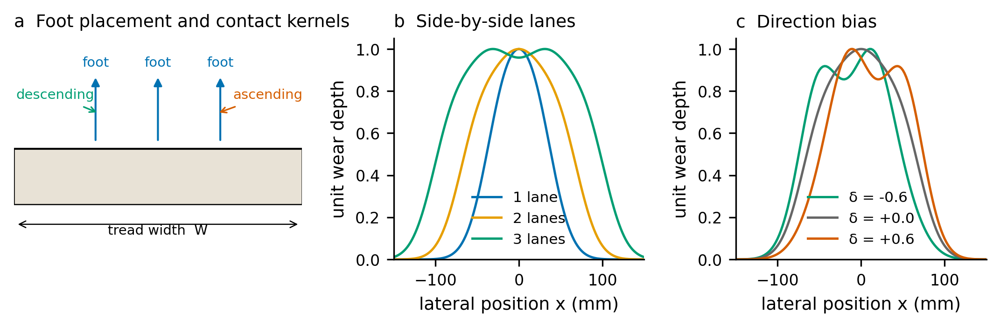
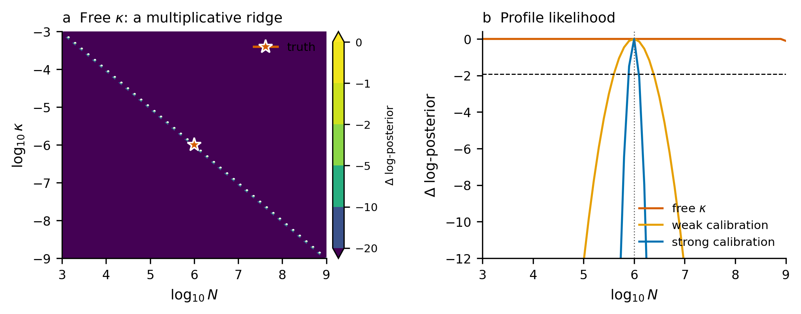
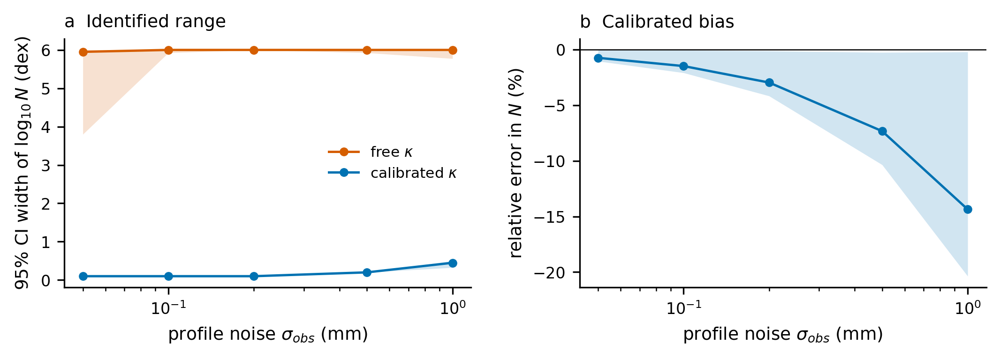
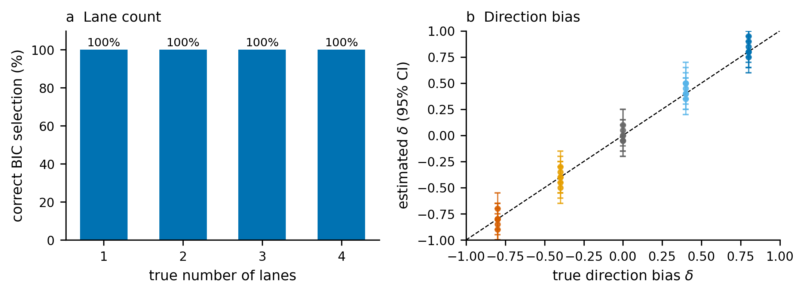
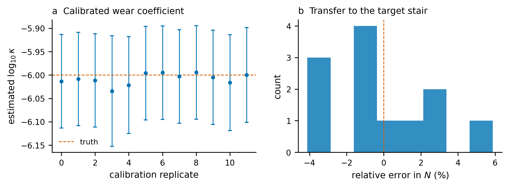
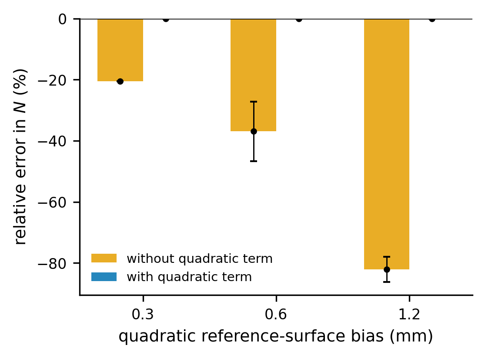
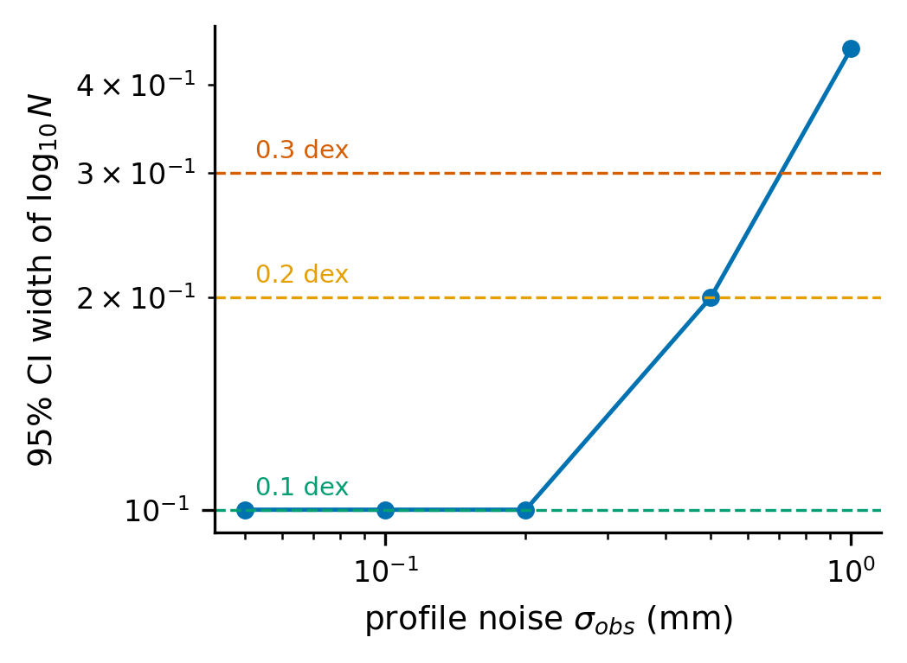
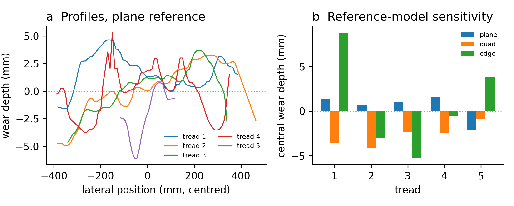
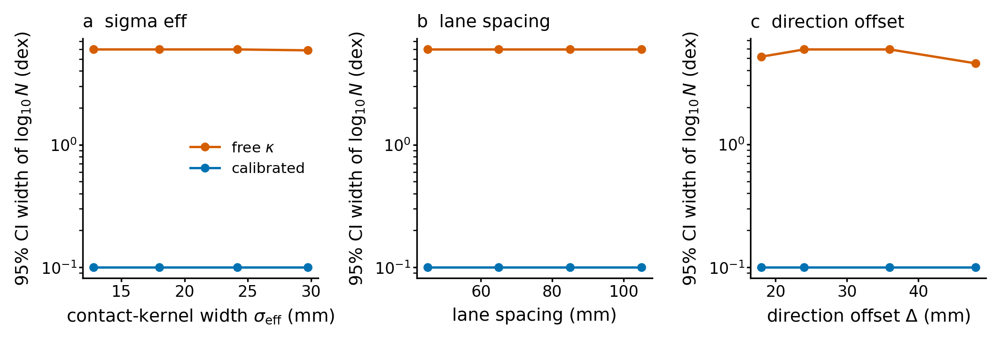

# What worn stair treads can and cannot tell: identifiability, calibration, and measurement design for wear-based inspection of historic stairs

---

## Abstract

Worn stair treads are evidence of past use and a deterioration indicator in historic buildings. Recent studies fit Archard-type wear laws to scanned profiles and report a single traffic number. The inference is structurally ambiguous: the number of footfalls \(N\) and the wear coefficient \(\kappa\) enter the profile only through their product, so a profile constrains \(\kappa N\) but not \(N\). Using a lateral wear model and profile likelihood, we show that a free \(\kappa\) leaves the 95% interval for \(N\) spanning six orders of magnitude. Calibration on staircases with known cumulative traffic reduces the interval to about 0.1 dex and recovers \(N\) with about 3% bias at 0.2 mm profile noise. Reference-surface error is a first-order bias; on a public Roman marble scan, three defensible reference models change the apparent wear from -5.3 to +8.8 mm and flip its sign. A published Borobudur wear rate bounds the interval but introduces a material-dependent bias. The paper ends with a measurement protocol for non-destructive inspection of historic stairs. The practical recommendation is to report the identified product, the calibration, and the confidence interval, and to design the survey around the calibration staircase rather than the scanner.

**Keywords:** **stair wear / architectural heritage / identifiability / calibration / non-destructive inspection / measurement uncertainty**

---

## 1. Introduction

Stone, brick, and wooden stairs are among the most heavily used surfaces in historic buildings, and the least documented. A staircase may serve a building for centuries; its treads record the cumulative passage of people long after written visitor records have disappeared. In conservation, this record matters in two opposite directions. Wear is a deterioration mechanism that threatens the fabric and the safety of users (Delgado Rodrigues, 2015; Doehne and Price, 2010; Siegesmund and Snethlage, 2014). It is also a proxy for past use, and therefore a source of archaeological evidence about circulation, access, and daily life. Both arguments require the same quantitative step: converting a measured wear profile into a statement about use, with an honest uncertainty.

Wear of materials under sliding contact is classically described by Archard's law, \(V = k F s / H\), where \(V\) is worn volume, \(F\) the normal load, \(s\) the sliding distance, \(H\) the surface hardness, and \(k\) a dimensionless wear coefficient (Archard, 1953; Rabinowicz, 1995; Bhushan, 2013; Hutchings and Shipway, 2017). For a stair tread, the law can be written in differential form and integrated over footfalls. The appeal is that the wear depth should grow linearly with the number of steps and with the load, and inversely with hardness. The difficulty is that \(k\), \(H\), the contact pressure distribution, and the number of footfalls are not independently measured on a historic staircase. A fitted model can always trade one against another.

The heritage literature has approached stair wear from two directions. Conservation science describes deterioration patterns, material loss, salt weathering, and the environmental agents that accompany use (Charola, 2000; Delgado Rodrigues, 2015; Doehne and Price, 2010). Tribology and biomechanics describe contact, friction, and the kinematics of stair ascent and descent (Johnson, 1985; Riener et al., 2002). Three-dimensional documentation provides the geometric observable: photogrammetry and laser scanning can now recover tread microtopography at sub-millimetre to millimetre precision, non-destructively and at modest cost (Remondino, 2011).

A cluster of very recent studies has connected these strands by fitting Archard-type models to scanned stairs. Li et al. (2025) combine laser scanning and photogrammetry with a Gaussian simulation of wear and report agreement between measured and predicted depths. Cao et al. (2025) relate measured wear depth to cumulative usage frequency. Lu et al. (2025) estimate total pedestrian traffic from scanned wear volume and use Gaussian-mixture clustering to infer direction. Cai et al. (2025) compare Monte Carlo and contact-mechanics models for continuous wear steps. Mao et al. (2026) propose a multidimensional wear-modelling and historical-inference framework. Most directly, Yu et al. (2026) formulate a physics-informed Bayesian inversion of historical stair usage from geometric wear profiles, test it on synthetic scenarios and a public 3D model, and report that pedestrian volume and the wear coefficient show strong compensation.

High-resolution stair-traffic datasets now exist (Kuligowski et al., 2014; Pouw et al., 2024), and three-dimensional documentation of heritage stairs is increasingly available (Remondino, 2011). What is missing is the join: we are not aware of a public dataset that pairs a measured tread profile with a known cumulative footfall for the same staircase. The gap is not a lack of scanners or counters, but a lack of calibration.

That last observation is the starting point of this paper. If volume and wear coefficient compensate, then a single profile cannot identify either. A posterior that appears precise is then an artefact of the prior, not a property of the data. The heritage literature has not yet answered three questions that determine whether wear-based inference is credible:

1. **Structural identifiability.** Which combinations of parameters are constrained by a tread profile, and which are not?
2. **Calibration.** What independent measurement breaks the degeneracy, and how much does it reduce uncertainty?
3. **Measurement design.** How precise must the scan be, how many treads and profiles are needed, and what reference-surface error is tolerable?

This paper addresses these questions with a deliberately transparent model. We do not claim a full contact-mechanics simulation of a shoe on stone; we use a lateral wear model that retains the parameters that matter for inference (traffic, direction bias, lane structure, wear coefficient, reference surface) and that can be analysed exactly enough to expose identifiability. We then use penalised profile likelihood, which shows flat directions instead of hiding them, and we evaluate the calibration design in simulation.

Our contributions are:

1. A minimal forward model of lateral tread wear that separates the scale parameter \(\kappa N\) from the shape parameters (direction bias and lane count), and an explicit demonstration that \(N\) and \(\kappa\) are multiplicatively non-identifiable from a profile alone.
2. A calibration design based on staircases with known cumulative traffic, with uncertainty propagation from the calibration to the target staircase.
3. A simulation study that quantifies the effect of profile noise, lane count, direction bias, and reference-surface error on the recoverable quantities.
4. A field protocol, derived from the simulation, that specifies scan precision, sampling layout, calibration-stair criteria, and reporting standards.
5. A real-geometry stress test on a public Roman marble staircase, showing that the reference-surface ambiguity persists on a real scan.
6. A three-tier calibration analysis (none, literature anchor, direct), showing what each tier can and cannot support.

The practical message is intentionally conservative. Wear-based inference should not report a single number for historical traffic. It should report the identified combination, the calibration that breaks the degeneracy, and a confidence interval that reflects what the data can support.

---

## 2. Materials and methods

### 2.1. Forward wear model

We consider a tread of width \(W\) and use the lateral coordinate \(x\in[-W/2,W/2]\). The observable is the wear depth \(h(x)\), measured relative to the reconstructed unworn surface and averaged over a longitudinal strip of the tread. A footfall at lateral position \(c\) removes material with a contact-pressure kernel \(p(x-c)\). Foot placements follow a density \(g(c)\). For \(N\) footfalls, the expected wear depth is

\[
h(x)=\kappa N\,(g*p)(x)+e(x),
\qquad \kappa=\frac{k}{H},
\qquad (1)
\]

where \(k\) is the wear coefficient, \(H\) the surface hardness, and \(e(x)\) a smooth term representing environmental loss and reference-surface error. The convolution is the model's central object: the profile is the product of a scale, \(\kappa N\), and a shape determined by where people step.

Directional preference is represented by two contact kernels, one for ascending and one for descending, whose centroids are separated by a lateral offset \(\Delta\). With ascending fraction \(f_a=(1+\delta)/2\) and descending fraction \(f_d=1-f_a\), where \(\delta\in[-1,1]\) is the direction bias, the shape is

\[
s(x)=\frac{1}{L}\sum_{\ell=1}^{L}\left[f_a\,G\!\left(x-c_\ell-\frac{\Delta}{2};\sigma\right)
+f_d\,G\!\left(x-c_\ell+\frac{\Delta}{2};\sigma\right)\right],
\qquad (2)
\]

where \(G\) is a Gaussian kernel, \(c_\ell\) are lane centres, \(L\) is the number of side-by-side lanes, and \(\sigma\) combines foot-placement and contact-kernel width. The shape is normalised to unit peak, so that the peak wear depth is \(\kappa N\). Lane centres are equally spaced with spacing \(d\): \(c_\ell=(\ell-(L+1)/2)d\).

The environmental and reference-surface term is modelled as

\[
e(x)=e_0+q\left(\frac{x}{W/2}\right)^2,
\qquad (3)
\]

where \(e_0\ge 0\) is a uniform loss and \(q\ge 0\) is a quadratic bow. A non-zero \(q\) is the geometric signature of an initially non-planar tread or of an imperfect reference-surface reconstruction.

The model is deliberately one-dimensional in the lateral direction. It ignores the longitudinal profile along the tread depth, the detailed geometry of the shoe sole, and the nonlinearity of contact as the tread hollows. These omissions are discussed in Section 4.4. They are acceptable here because the inference questions concern lateral traffic structure and scale, and because the model's parameters map directly onto measurable quantities.

### 2.2. Observation model and reference surface

The measured profile is

\[
h_{\mathrm{obs}}(x_i)=h(x_i)+\varepsilon_i,
\qquad \varepsilon_i\sim\mathcal{N}(0,\sigma_{\mathrm{obs}}^2),
\qquad (4)
\]

at \(M\) lateral positions \(x_i\). The noise \(\sigma_{\mathrm{obs}}\) represents scan precision, registration error, and reference-surface uncertainty. In the simulations we vary \(\sigma_{\mathrm{obs}}\) from 0.05 to 1.0 mm, spanning structured-light and photogrammetric performance. Close-range photogrammetric practice for cultural heritage is well documented (Historic England, 2017); the binding constraint here is not the scanner but the reference surface.

The reference surface is the largest practical uncertainty. We reconstruct it from unworn edges, an unused neighbouring tread, or a plane fitted to the outer 20% of the tread, and we represent the residual as the quadratic term in Eq. (3). Section 3.3 quantifies the bias when this term is ignored.

### 2.3. Inference

We estimate the parameter vector \(\theta=(\log_{10}N,\delta,\log_{10}\kappa,e_0,q)\) by maximising the penalised log-posterior

\[
\log \pi(\theta\mid h_{\mathrm{obs}})
=-\frac{1}{2\sigma_{\mathrm{obs}}^2}\sum_{i=1}^{M}\left[h_{\mathrm{obs}}(x_i)-h(x_i;\theta)\right]^2
+\log p(\theta),
\qquad (5)
\]

with bounded uniform priors on \(\log_{10}N\), \(\delta\), and \(\log_{10}\kappa\), a half-normal prior on \(e_0\), and a half-normal prior on \(q\). When a calibration is available, the uniform prior on \(\log_{10}\kappa\) is replaced by a normal prior \(\mathcal{N}(\mu_\kappa,\sigma_\kappa^2)\) obtained from the calibration staircases (Section 2.4).

We do not summarise Eq. (5) with a single posterior mean. We profile it: for each value of a parameter of interest, the remaining parameters are re-optimised, and the profile

\[
\mathrm{PL}(\theta_j)=\max_{\theta_{-j}}\log\pi(\theta_j,\theta_{-j}\mid h_{\mathrm{obs}})
\qquad (6)
\]

is reported. A 95% confidence interval is the set of \(\theta_j\) for which \(\mathrm{PL}(\theta_j)\ge \mathrm{PL}_{\max}-1.92\), the chi-square threshold with one degree of freedom. If the profile is flat across the prior range, the parameter is not identified, and we say so. This is the practical-identifiability approach used in systems biology (Raue et al., 2009; Kreutz et al., 2013; Wieland et al., 2021), applied here to a heritage inverse problem.

For the discrete lane count \(L\), we fit \(L=1,\ldots,4\) and select the model with the smallest Bayesian information criterion, \(\mathrm{BIC}=-2\log\hat{\pi}+k\ln M\), where \(k\) is the number of fitted parameters (Burnham and Anderson, 2002).

### 2.4. Calibration on stairs with known traffic

The degeneracy in Eq. (1) is broken by an independent estimate of \(\kappa\). We use staircases whose cumulative footfall \(N_{\mathrm{cal}}\) is known from door counters, turnstiles, or documented visitor records, and whose tread profiles can be measured in the same way as the target. With \(N\) fixed at \(N_{\mathrm{cal}}\), the profile is linear in \(\kappa\), and a profile-likelihood fit gives \(\hat\kappa\) and its uncertainty. For \(S\) calibration staircases we combine the estimates in log space:

\[
\mu_\kappa=\frac{1}{S}\sum_{s=1}^{S}\log_{10}\hat\kappa_s,
\qquad
\sigma_\kappa^2=\frac{1}{S}\left[\frac{1}{S-1}\sum_{s=1}^{S}\left(\log_{10}\hat\kappa_s-\mu_\kappa\right)^2\right]+\sigma_{\mathrm{site}}^2,
\qquad (7)
\]

where \(\sigma_{\mathrm{site}}\) is a site-to-site term representing material and maintenance variability. The first term is the standard error of the mean; the second prevents the calibration from being overconfident when the staircases are few or similar.

For a target profile with peak wear \(h_{\max}\), the first-order propagation is

\[
\log_{10}N=\log_{10}h_{\max}-\mu_\kappa-\log_{10}s_{\max},
\qquad
\frac{\sigma_N}{N}\approx\ln(10)\,\sigma_\kappa,
\qquad (8)
\]

where \(s_{\max}=1\) for the normalised shape. Equation (8) makes the value of calibration explicit: the relative uncertainty in \(N\) is approximately 2.303 times the uncertainty in \(\log_{10}\kappa\).

### 2.5. Simulation design

The synthetic truth is \(N=10^6\) footfalls, \(\delta=0.3\), \(\kappa=10^{-6}\) mm per footfall, \(L=2\), \(W=300\) mm, lane spacing 65 mm, direction offset 36 mm, and \(\sigma=24\) mm (combined foot-placement and contact width). Profiles are sampled at 2 mm intervals across the tread. The default noise is \(\sigma_{\mathrm{obs}}=0.2\) mm, a realistic value for close-range photogrammetry.

Six blocks are run:

- **A. Identifiability.** Twelve replicate profiles are fitted with (i) free \(\kappa\), (ii) a weak calibration prior (\(\sigma_\kappa=0.20\) dex), and (iii) a strong calibration prior (\(\sigma_\kappa=0.05\) dex). We report the 95% interval width for \(\log_{10}N\), coverage of the true value, and whether the interval is finite within the prior range.
- **B. Noise.** \(\sigma_{\mathrm{obs}}\in\{0.05,0.1,0.2,0.5,1.0\}\) mm, six replicates, free versus calibrated \(\kappa\).
- **C. Lane count.** \(L\in\{1,2,3,4\}\), ten replicates, BIC selection accuracy.
- **D. Direction bias.** \(\delta\in\{-0.8,-0.4,0,0.4,0.8\}\), six replicates, profile-likelihood estimates and coverage.
- **E. Calibration transfer.** Three calibration staircases with \(N_{\mathrm{cal}}\in\{2\times10^5,5\times10^5,10^6\}\) and 0.1 mm noise; \(\kappa\) is estimated and propagated to a target profile, twelve replicates.
- **F. Reference surface.** Quadratic bias \(q\in\{0.3,0.6,1.2\}\) mm, six replicates, fitted with and without the quadratic term.

The code, synthetic data, and figure scripts are provided as supplementary material. All random seeds are recorded. AI-assisted tools were used to draft parts of the analysis code; the author verified the code and all results.

### 2.6. Inspection protocol

The protocol has five steps. (1) Document the staircase: construction or installation date, material and surface treatment, maintenance history, and any traffic records. (2) Choose a calibration tier: direct calibration on one or more staircases with known cumulative traffic; a literature prior with an explicit material caveat; or no calibration, in which case only the product \(\kappa N\) can be reported. (3) Measure five consecutive treads per staircase, with three longitudinal profiles per tread (left, centre, right) and one transverse profile at mid-depth. Check the scale against the step height, and check repeatability by scanning one tread three times, following ISO (2019); propagate uncertainty following JCGM (2008). (4) Reconstruct the reference surface from unworn edges or an unused neighbouring tread, record the residual, fit the model, inspect the residual, and profile the quantity of interest. (5) Report the identified quantity, the calibration source, the reference-surface residual, and a confidence interval. Table 2 translates these steps into decision rules for inspection practice. The full protocol, including the metadata schema and quality-control checklist, is in Supplementary Material S1.

---

## 3. Results

### 3.1. Identifiability and calibration

Figure 2a shows the penalised log-posterior slice in the \((\log_{10}N,\log_{10}\kappa)\) plane for a free \(\kappa\). The posterior is a narrow diagonal ridge: the data constrain \(\log_{10}N+\log_{10}\kappa\), not either parameter separately. The profile likelihood in Figure 2b makes the consequence explicit. With free \(\kappa\), the 95% interval for \(\log_{10}N\) spans the entire prior range of six orders of magnitude, and no replicate is identified (0/12; median width 6.0 dex). Because the profile is flat, we do not report a point estimate of \(N\) in this case: the interval, not its midpoint, is the result.

A weak calibration prior of 0.20 dex (a factor of 1.6) already breaks the degeneracy: the interval narrows to a median of 0.7 dex, and all replicates are identified. A strong calibration prior of 0.05 dex (12%) narrows the interval to 0.1 dex (26%), with complete coverage of the true value (12/12). The contrast between the three cases is the paper's central result: the profile is informative about \(N\) only in proportion to what is known about \(\kappa\).

**Calibration transfer.** Figure 5a shows the calibration estimates from three known-traffic staircases. The recovered \(\log_{10}\kappa\) is centred on the true value with a standard deviation of 0.012 dex; the site-to-site term dominates the combined uncertainty. When the calibrated prior is transferred to the target profile, the median relative error in \(N\) is -0.5% (interquartile range -1.6% to +1.3%), and the 95% interval covers the truth in 100% of replicates (Figure 5b). The residual bias is small compared with the interval width.

### 3.2. Measurement design

**Profile noise.** Figure 3a shows the 95% interval width for \(\log_{10}N\) as a function of profile noise. With free \(\kappa\), the interval remains at the prior scale at every noise level: more precise scanning does not identify traffic. With calibrated \(\kappa\), the interval grows from 0.10 dex at 0.05 mm to 0.45 dex at 1.0 mm; the coverage is 100% up to 0.2 mm and 83% at 0.5 and 1.0 mm. The practical implication is that scan precision matters only after calibration; before calibration, the binding constraint is the material coefficient, not the scanner. Figure 3b shows the calibrated bias: at 0.2 mm noise the median relative error is -3.0% (interquartile range -4.2% to -0.1%), and it grows to -14.4% at 1.0 mm, where the profile shape is poorly resolved.

**Lane count.** BIC selects the correct number of lanes in 100% of cases overall (Figure 4a), and the result is unchanged when \(\kappa\) is free rather than calibrated. The separation is expected to degrade when adjacent peaks overlap at smaller lane spacing or higher noise; the present simulation uses 65 mm spacing and 0.2 mm noise, which keeps the peaks resolved. Lane count is a shape parameter, so it does not rescue the scale.

**Direction bias.** Figure 4b shows the profile-likelihood estimates of \(\delta\). The estimates follow the one-to-one line; the 95% intervals are about ±0.15 wide, and coverage is 100%. Direction bias is a second-order shape parameter: it changes the asymmetry of the profile, not its scale, and it is detectable only when the ascending–descending contact offset is large relative to the profile noise. At the 36 mm offset used here and 0.2 mm noise, biases of about 0.4 and above are distinguishable from zero; the detection limit lies between 0 and 0.4 and should be established for each site. This is a statement about the measurement design, not about the absence of a preference.

**Precision nomogram.** Figure 7 combines the noise sweep into a design curve: for a target 95% interval width of 0.1, 0.2, or 0.3 dex in \(\log_{10}N\), the curve gives the required profile noise after calibration. At 0.1 dex (26%), the requirement is approximately 0.2 mm; at 0.2 dex (58%), 0.5 mm; at 0.3 dex (factor 2), 0.75 mm. These values are within the range of close-range photogrammetry with a scale bar under good conditions, provided the reference surface is controlled.

**Model assumptions.** To test whether the identifiability result is an artefact of the baseline geometry, we varied the contact-kernel width (13–30 mm), lane spacing (45–105 mm), and direction offset (18–48 mm). Across all settings, the median free-\(\kappa\) interval remained at the prior scale (4.6–6.0 dex; one replicate at the widest lane spacing gave 1.6 dex, where the two peaks are well separated), and the calibrated interval remained 0.1–0.2 dex; the calibrated bias stayed within 11% (Figure 9). The product confound is therefore structural, and the calibrated precision is robust to the kernel width, lane spacing, and direction offset tested here.

### 3.3. Reference-surface error

Figure 6 shows the effect of a quadratic reference-surface error. When the quadratic term is omitted from the model, a 0.6 mm bow biases \(N\) by 37% and a 1.2 mm bow by 82%; the bias is systematic and does not average out across replicates. When the quadratic term is fitted, the bias falls below the 0.1 dex grid resolution and the interval covers the truth in 100% of replicates. The reference surface is therefore not a nuisance to be ignored: it is a first-order term in the error budget.

### 3.4. A real scan does not remove the reference-surface ambiguity

To test the pipeline on real geometry, we applied it to the public "Roman marble stairs" model (CC BY 4.0; chabychab). The model contains five usable treads with widths between 0.25 and 1.0 m. We segmented each tread, extracted a lateral profile at mid-depth, and computed the apparent wear under three defensible reference models: a plane fitted to the outer 15% ring, a quadratic in width fitted to the outer 20%, and the median of the outer 10% edges. The central wear estimate ranged from \(-5.3\) to \(+8.8\) mm across the three models, and its sign was not stable (Figure 8). For the one tread on which all three estimates were positive, the implied \(N\) differed by a factor of 6.3. The scan alone therefore does not identify the reference surface, and consequently does not identify \(N\). This is the real-geometry counterpart of the simulation result in Section 3.3. We do not report a traffic estimate for this model: the exercise is a stress test, not a calibration. The photogrammetric surface is not metrology-grade, and the treads are curved; both facts add noise, but they do not remove the structural ambiguity that the three reference models expose.

### 3.5. A literature anchor bounds but does not calibrate

A field campaign is not always possible. Is a published wear rate enough? A projection attributed to the Borobudur Conservation Office and reported in the Indonesian press gives 1.8 cm of wear per 50 million visitors (average visitor mass 60 kg), i.e. an effective \(\kappa\approx3.6\times10^{-7}\) mm per visitor (Tribunnews, 2015; grey literature). This is an average over the staircase surface, not a single-point measurement, and the stone is andesite, not the marble of the simulation. We therefore treat it as a prior, not a calibration.

With a prior of \(\log_{10}\kappa=-6.44\) and a standard deviation of 0.30 dex, the 95% interval for \(N\) narrows from six orders of magnitude to 1.1 dex (Table 1). The point estimate, however, is biased by +172% because the anchor is 0.44 dex below the simulation's true \(\kappa\); the interval covers the truth only because it is wide. A 0.50 dex prior widens the interval to 1.9 dex without removing the bias. A direct calibration on three known-traffic staircases gives a 0.1 dex interval and a bias of \(-0.5\%\). A literature anchor is therefore useful for bounding an order of magnitude, but it cannot substitute for a material-specific calibration.

---

## 4. Discussion

### 4.1. What the data can and cannot support

The results support a simple rule. A wear profile identifies the product \(\kappa N\) and the shape parameters (lane count, and direction bias when the offset is large). It does not identify \(N\) or \(\kappa\) separately. A study that reports a traffic number without an independent calibration is reporting a prior, not a measurement. This is not a criticism of any particular model; it is a structural property of the Archard-type observation equation, and it applies to the recent stair-wear literature as much as to ours. Yu et al. (2026) make the same observation in a Bayesian framework; our contribution is to quantify it with profile likelihood, to show how calibration removes it, and to translate the result into measurement requirements.

The calibration design is deliberately modest. Three staircases with known traffic, five treads each, and a 14-day count are enough to reduce the \(N\) interval from six orders of magnitude to about 0.1 dex in simulation. The dominant uncertainty is not the scanner but the site-to-site variability of \(\kappa\), which is why Eq. (7) includes an explicit \(\sigma_{\mathrm{site}}\) term. In practice, calibration staircases should span materials and maintenance regimes; a single polished marble staircase will not calibrate a weathered limestone one.

### 4.2. Relation to previous work

The recent stair-wear papers differ mainly in the inversion machinery: Gaussian simulation (Li et al., 2025), direct Archard inversion (Cao et al., 2025), GMM clustering (Lu et al., 2025), Monte Carlo and contact mechanics (Cai et al., 2025), multidimensional modelling (Mao et al., 2026), and Bayesian inversion (Yu et al., 2026). Our model is simpler in its contact description and more explicit about identifiability. The simplicity is intentional: a model with more parameters cannot repair a degeneracy that is already present at the level of Eq. (1). The appropriate response to the degeneracy is an independent measurement, not a stronger prior.

The heritage-conservation literature contributes the material and environmental terms that our model compresses into \(\kappa\) and \(e(x)\). Salt weathering, freeze–thaw, and biological growth are not wear in the tribological sense, but they change the reference surface and the apparent wear depth (Charola, 2000; Doehne and Price, 2010). A field study should measure them separately or include them in the reference-surface term; otherwise they will be absorbed into \(N\).

### 4.3. Implications for heritage management

For conservation practice, the result argues for a change in reporting. A wear survey should state (i) the identified combination \(\kappa N\), (ii) the calibration source and its uncertainty, (iii) the reconstructed reference surface and its residual, and (iv) a confidence interval for any traffic number. The same logic applies to the use of wear as a conservation indicator: a change in wear rate can be detected only if the material coefficient and the reference surface are stable. The protocol in Supplementary Material S1 is designed to make these requirements operational for a small team with a camera, a scale bar, and a door counter.

For archaeology, the result is both limiting and enabling. Limiting, because a single staircase cannot yield an absolute traffic history. Enabling, because a calibrated staircase can, and because the shape parameters (lanes, direction bias) are recoverable even without calibration. A two-tier strategy follows: use shape parameters to compare staircases and infer circulation patterns, and reserve absolute traffic estimates for staircases that can be calibrated.

### 4.4. Limitations

The model is one-dimensional in the lateral direction and treats the contact kernel as Gaussian and fixed. It does not resolve the longitudinal profile, the hollowing of the tread, or the change in contact area as wear progresses. These effects are second-order for the lateral shape but first-order for the absolute wear rate; a field calibration absorbs them into \(\kappa\), which is appropriate only if the calibration staircase and the target have similar geometry and material.

The simulation is synthetic. The parameters are plausible but not fitted to a particular site, and the noise model is Gaussian. We applied the pipeline to one public model (Section 3.4); it confirms that the reference-surface bottleneck persists on real geometry, but that exercise is a stress test, not a calibration. The next step is a field application with at least three calibration staircases and three application staircases; the code is structured for that step (Supplementary Material S2). The Borobudur anchor in Section 3.5 is a projection from grey literature, not a measured per-point value; it is included to show what a literature prior can and cannot do, not as a substitute for field data.

The calibration assumes that cumulative traffic is known. Door counters fail, visitor records are incomplete, and a staircase may serve only a fraction of building entrants. The protocol addresses this with a 14-day manual count and an explicit usage fraction, but the uncertainty in \(N_{\mathrm{cal}}\) propagates directly into \(\kappa\) and therefore into the target \(N\). Future work should treat calibration as a hierarchical Bayesian problem with errors-in-variables, rather than a two-step point estimate.

### 4.5. Future work

Three extensions are immediate. First, a three-dimensional forward model that resolves the longitudinal profile and the evolution of contact area would test whether the lateral degeneracy is the dominant one. Second, a hierarchical calibration across materials and sites would replace the site-to-site term in Eq. (7) with a learned variance component. Third, a field application with the protocol in Supplementary Material S1 would provide the first calibrated traffic estimates for historic stairs; the public models are a natural geometric benchmark, but they lack known traffic and can test only the pipeline, not the calibration.

---

## 5. Conclusions

Worn stairs are often described as a clock. This paper shows that the clock has two hands, traffic and material wear, and that a profile alone cannot tell them apart. The 95% interval for traffic spans six orders of magnitude when the wear coefficient is free. Calibration on staircases with known traffic breaks the degeneracy and reduces the interval to about 0.1 dex in simulation. Lane count is recoverable from shape; direction bias is recoverable only when the contact offset is large relative to noise; reference-surface error is a first-order bias, not a nuisance. A real scan and a literature anchor do not remove the ambiguity: the scan cannot fix the reference surface, and the anchor narrows the interval but carries a material bias. The practical recommendation is to report the identified combination, the calibration, and the interval, and to design the survey around the calibration staircase rather than the scanner.

---

## Declarations

**Data availability.** The code and synthetic data that support the findings of this study are openly available in GitHub at https://github.com/YuhaoPeng1103/stair-wear. The field protocol is provided as Supplementary Material S1. No field data were collected for this study. The public 3D models used in Section 3.4 are CC BY 4.0: "Roman marble stairs" and "Paestum old stairs" by chabychab, and "Stair over an arch - Umm Qais Museum" by SJoudeh (Sketchfab; URLs in Supplementary Material S2).

**Ethics.** Not applicable. The study uses synthetic data and published 3D models; no human participants or sensitive sites were involved. Field work under the protocol requires site permission and will follow the guidelines of the participating heritage authority.

**Author contributions (CRediT).** The sole author performed all roles: conceptualization, methodology, software, formal analysis, writing – original draft, and writing – review and editing.

**Competing interests.** The author declares no competing interests.

**Funding.** This research did not receive any specific grant from funding agencies in the public, commercial, or not-for-profit sectors.

## Declaration of generative AI and AI-assisted technologies in the manuscript preparation process

During the preparation of this work the author used Claude Code (Anthropic), version 2.1.310, in order to edit language and draft parts of the analysis code. After using this tool, the author reviewed and edited the content as needed and takes full responsibility for the content of the published article.

## References

Archard, J.F., 1953. Contact and rubbing of flat surfaces. Journal of Applied Physics 24, 981–988. <https://doi.org/10.1063/1.1721448>

Bhushan, B., 2013. Principles and Applications of Tribology, 2nd ed. Wiley, Hoboken, NJ.

Burnham, K.P., Anderson, D.R., 2002. Model Selection and Multimodel Inference: A Practical Information-Theoretic Approach, 2nd ed. Springer, New York.

Cai, J., Xie, Z., Cai, Q., 2025. Predictive models for the continuous wear step problem, in: Civil Engineering and Smart Structure Technology. IOS Press. <https://doi.org/10.3233/ATDE250215>

Cao, R., Zheng, H., Wu, J., Zhang, W., 2025. Usage frequency on historic stone stairs: a quantitative model based on Archard's wear law. Journal of Applied Mathematics and Computation 9, 266–271. <https://doi.org/10.26855/jamc.2025.12.006>

Charola, A.E., 2000. Salts in the deterioration of porous materials: an overview. Journal of the American Institute for Conservation 39, 327–343. <https://doi.org/10.1179/019713600806113176>

Delgado Rodrigues, J., 2015. Defining, mapping and assessing deterioration patterns in stone conservation projects. Journal of Cultural Heritage 16, 267–275. <https://doi.org/10.1016/j.culher.2014.06.007>

Doehne, E., Price, C.A., 2010. Stone Conservation: An Overview of Current Research, 2nd ed. Getty Conservation Institute, Los Angeles.

Historic England, 2017. Photogrammetric Applications for Cultural Heritage: Guidance for Good Practice. Historic England, Swindon. <https://historicengland.org.uk/images-books/publications/photogrammetric-applications-for-cultural-heritage/>

Hutchings, I.M., Shipway, P., 2017. Tribology: Friction and Wear of Engineering Materials, 2nd ed. Butterworth-Heinemann, Oxford.

ISO, 2019. ISO 5725-2:2019 Accuracy (Trueness and Precision) of Measurement Methods and Results — Part 2: Basic Method for the Determination of Repeatability and Reproducibility of a Standard Measurement Method. ISO, Geneva.

JCGM, 2008. JCGM 100:2008 Evaluation of Measurement Data — Guide to the Expression of Uncertainty in Measurement. BIPM, Sèvres.

Johnson, K.L., 1985. Contact Mechanics. Cambridge University Press, Cambridge.

Kreutz, C., Raue, A., Kaschek, D., Timmer, J., 2013. Profile likelihood in systems biology. FEBS Journal 280, 2564–2571. <https://doi.org/10.1111/febs.12276>

Kuligowski, E.D., Peacock, R.D., Reneke, P.A., Wiess, E., Averill, J.D., Hagwood, C.R., Ronchi, E., Hoskins, B.L., Spearpoint, M., 2014. Movement on Stairs During Building Evacuations. NIST Technical Note 1839. <https://doi.org/10.6028/NIST.TN.1839>

Li, J., Li, X., Li, R., 2025. A study on stair wear prediction based on Archard's equation and Gaussian simulation. Highlights in Science, Engineering and Technology 156, 22–28. <https://doi.org/10.54097/yawxst60>

Lu, Z., Huang, H., Sun, Z., Wang, Z., 2025. Quantifying staircase wear in historic buildings using GMM and MCMC methods, in: Proceedings of the 2025 5th International Conference on Applied Mathematics, Modelling and Intelligent Computing. ACM, pp. 659–665. <https://doi.org/10.1145/3745533.3745639>

Mao, Z., Huang, Y., Xu, W., 2026. A multidimensional wear modeling and historical inference framework for staircase degradation analysis, in: Proceedings of the 1st International Conference on Smart System Design, Application and Mechatronics. SCITEPRESS, pp. 206–211. <https://doi.org/10.5220/0015109700005244>

Pouw, C.A.S., Corbetta, A., Gabbana, A., van der Laan, C., Toschi, F., 2024. High-statistics pedestrian dynamics on stairways and their probabilistic fundamental diagrams. Transportation Research Part C 159, 104468. <https://doi.org/10.1016/j.trc.2023.104468>

Rabinowicz, E., 1995. Friction and Wear of Materials, 2nd ed. Wiley, New York.

Raue, A., Kreutz, C., Maiwald, T., Bachmann, J., Schilling, M., Klingmüller, U., Timmer, J., 2009. Structural and practical identifiability analysis of partially observed dynamical models by exploiting the profile likelihood. Bioinformatics 25, 1923–1929. <https://doi.org/10.1093/bioinformatics/btp358>

Remondino, F., 2011. Heritage recording and 3D modeling with photogrammetry and 3D scanning. Remote Sensing 3, 1104–1138. <https://doi.org/10.3390/rs3061104>

Riener, R., Rabuffetti, M., Frigo, C., 2002. Stair ascent and descent at different inclinations. Gait & Posture 15, 32–44. <https://doi.org/10.1016/S0966-6362(01)00162-X>

Siegesmund, S., Snethlage, R. (Eds.), 2014. Stone in Architecture: Properties, Durability, 5th ed. Springer, Berlin.

Tribunnews, 2015. Cegah keausan batu, pengunjung Borobudur diharuskan pakai sandal khusus. 13 October 2015. <https://www.tribunnews.com/regional/2015/10/13/cegah-keausan-batu-pengunjung-borobudur-diharuskan-pakai-sandal-khusus> (grey literature; reports a Borobudur Conservation Office projection).

Wieland, F.-G., Hauber, A.L., Rosenblatt, M., Tönsing, C., Timmer, J., 2021. On structural and practical identifiability. Current Opinion in Systems Biology 25, 60–69. <https://doi.org/10.1016/j.coisb.2021.03.005>

Yu, J., Zhong, Y., Luo, Z., Guo, Y., Hu, J., 2026. Physics-informed inference of historical stair usage from geometric wear profiles in heritage structures. Applied Sciences 16, 6025. <https://doi.org/10.3390/app16126025>

---

## Tables

| Calibration source | Prior SD (dex) | 95% CI width (dex) | Median bias in \(N\) | Coverage |
|---|---:|---:|---:|---:|
| None | — | 6.0 | not defined | — |
| Borobudur anchor | 0.30 | 1.1 | +172% | 100% |
| Borobudur anchor | 0.50 | 1.9 | +172% | 100% |
| Direct calibration | 0.05 | 0.1 | \(-0.5\%\) | 100% |

**Table 1.** Three calibration tiers on the synthetic benchmark. The literature anchor narrows the interval but introduces a material-dependent bias; only the direct calibration is both narrow and unbiased.

| Condition | What can be reported |
|---|---|
| No calibration and no literature prior | The product \(\kappa N\) only; not \(N\) |
| Literature prior only | \(N\) with a wide interval and a material caveat |
| Direct calibration on at least one known-traffic staircase | \(N\) with an interval; \(\kappa\) updated |
| Reference-surface residual >0.5 mm | Do not report \(N\); improve the reference |
| Profile noise >0.5 mm | Shape parameters only; \(N\) too uncertain |
| Lane-count BIC ambiguous | Single-file or unknown |
| Direction-bias interval includes zero | No evidence of a direction preference |
| Scale check fails (>0.5%) | Rescan; do not use the profile |

**Table 2.** Decision rules for reporting wear-based inference from a historic staircase.

---

## Figure captions

{width=100%}

**Figure 1.** Forward model. (a) Foot placement on a tread, with ascending and descending contact kernels; (b) unit wear profiles for one, two, and three side-by-side lanes; (c) profiles for direction bias \(\delta=-0.6,0,+0.6\) at two lanes. The shape is normalised to unit peak; the scale is \(\kappa N\).

{width=100%}

**Figure 2.** Identifiability. (a) Penalised log-posterior slice in the \((\log_{10}N,\log_{10}\kappa)\) plane with free \(\kappa\). The white contour is the 95% threshold; the star is the truth. (b) Profile likelihood for \(N\) under free \(\kappa\), weak calibration (\(\sigma_\kappa=0.20\) dex), and strong calibration (\(\sigma_\kappa=0.05\) dex). The dashed line is the 95% threshold; the dotted line is the truth.

{width=100%}

**Figure 3.** Measurement noise. (a) 95% interval width for \(\log_{10}N\) versus profile noise, free versus calibrated \(\kappa\); lines are medians, bands are interquartile ranges. (b) Relative error in \(N\) for the calibrated case.

{width=100%}

**Figure 4.** Shape parameters. (a) BIC accuracy for the number of lanes. (b) Profile-likelihood estimates of direction bias with 95% intervals; the dashed line is the one-to-one line.

{width=100%}

**Figure 5.** Calibration transfer. (a) Estimated \(\log_{10}\kappa\) from three known-traffic staircases; error bars are 95% intervals; the dashed line is the truth. (b) Relative error in \(N\) after transfer.

{width=100%}

**Figure 6.** Reference-surface error. Relative error in \(N\) for quadratic biases of 0.3, 0.6, and 1.2 mm, with and without the quadratic term in the model. With the term fitted, the bias falls below the 0.1 dex grid resolution, so those points lie at zero.

{width=100%}

**Figure 7.** Measurement-precision nomogram. 95% interval width for \(\log_{10}N\) versus profile noise after calibration; dashed lines mark 0.1, 0.2, and 0.3 dex.

{width=100%}

**Figure 8.** Real-geometry stress test on the public Roman marble staircase (CC BY 4.0). (a) Lateral profiles for five treads under a plane reference fitted to the outer 15% ring. (b) Central wear depth under three defensible reference models (plane, quadratic in width, edge median). The estimate changes sign and spans \(-5.3\) to +8.8 mm; the scan alone does not identify the reference surface, and therefore does not identify \(N\).

{width=100%}

**Figure 9.** Sensitivity to model assumptions. 95% interval width for \(\log_{10}N\) versus (a) contact-kernel width, (b) lane spacing, and (c) direction offset, under free and calibrated \(\kappa\). The free-\(\kappa\) interval remains at the prior scale; the calibrated interval remains near 0.1 dex.

---

## Supplementary material

**S1.** Field data collection protocol (calibration and application staircases, measurement layout, reference-surface reconstruction, metadata schema, quality control).

**S2.** Reproducible code and synthetic data (Python; forward model, profile likelihood, calibration, figure scripts).
